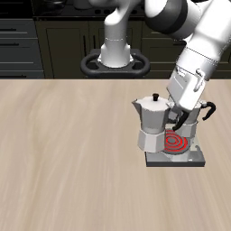
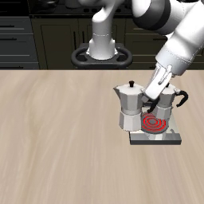

# RLT and π0.5 experiments on LIBERO

[中文说明](README.zh-CN.md)

Complete experiment code, evaluation records and **353 simulation videos** from the available RLT workspace snapshot. The repository covers a published RLT_a baseline and local π0.5/Moka direct-action optimization experiments. It includes the modified AlphaBrain source tree with its upstream MIT license, plus the complete local scripts, configuration examples, manifests and text results.

## Final held-out evaluation

The selected direct-action candidate was evaluated on LIBERO-10 Moka, initial states 40–49, seeds 789 and 1011. Both policies ran on the same 20 task/seed conditions.

| Policy | Successful episodes | Total episodes |
| --- | ---: | ---: |
| Base π0.5 | 12 | 20 |
| Candidate | 10 | 20 |

The candidate won on three individual conditions and lost on five. This final test **does not show an improvement** over the base policy. See the [summary](results/pi05_moka_direct_dense_interp_a050_20260910_remote_final/summary.json), [protocol](results/pi05_moka_direct_dense_interp_a050_20260910_remote_final/protocol.json), [individual episodes](results/pi05_moka_direct_dense_interp_a050_20260910_remote_final/episodes.json) and [all result groups](docs/results.md).

| Candidate succeeds, base fails (seed 789, state 42) | Base succeeds, candidate fails (seed 1011, state 42) |
| --- | --- |
|  |  |
| [Candidate video](results/pi05_moka_direct_dense_interp_a050_20260910_remote_final/candidate_seed789_init42_success.mp4) · [Base video](results/pi05_moka_direct_dense_interp_a050_20260910_remote_final/baseline_seed789_init42_fail.mp4) | [Base video](results/pi05_moka_direct_dense_interp_a050_20260910_remote_final/baseline_seed1011_init42_success.mp4) · [Candidate video](results/pi05_moka_direct_dense_interp_a050_20260910_remote_final/candidate_seed1011_init42_fail.mp4) |

These frames were extracted from the linked simulation recordings. Success labels come from the stored episode results, not visual inspection of a single frame.

## Repository layout

| Path | Contents |
| --- | --- |
| [`scripts/`](scripts/) | Training, evaluation, paired comparison, monitoring and report generation |
| [`src/AlphaBrain-opt/`](src/AlphaBrain-opt/) | Modified AlphaBrain implementation and its MIT license |
| [`config/`](config/) | LIBERO configuration example |
| [`manifests/`](manifests/) | Source, checkpoint and protocol provenance |
| [`results/`](results/) | Original JSON/CSV reports and all available MP4 experiment recordings |
| [`media/`](media/) | Frames from representative final-test recordings |

## Setup

1. Clone this repository and install the dependencies described in [`src/AlphaBrain-opt/README.md`](src/AlphaBrain-opt/README.md).
2. Place the upstream [LIBERO](https://github.com/Lifelong-Robot-Learning/LIBERO) checkout at `src/LIBERO` and [OpenPI](https://github.com/Physical-Intelligence/openpi) at `src/openpi`. Their source and simulator assets are provided by those projects.
3. Run `python scripts/configure_libero.py` to generate paths for your checkout, then source `scripts/env.sh` or `scripts/env_openpi.sh` as appropriate.
4. Obtain the base model from the original [AlphaBrainGroup weights](https://huggingface.co/AlphaBrainGroup/qwenoft-5traj-libero-goal). The local training checkpoints and replay arrays are bundled in the [v1.0 release assets](https://github.com/GuanliLee/rlt-libero-experiments/releases/tag/v1.0); extract the artifact at the repository root to restore their `results/` paths.

The `checkpoints/pi05_libero` base weight directory and Python environments are upstream dependencies and can be reconstructed separately. The provided code and results document the experiments; reproducing GPU runs requires compatible CUDA, LIBERO and model dependencies.

## Attribution

The modified implementation under `src/AlphaBrain-opt/` is derived from [AlphaBrainGroup/AlphaBrain](https://github.com/AlphaBrainGroup/AlphaBrain) and preserves its MIT license. LIBERO, OpenPI and the original model weights remain attributed to their upstream projects. This repository is an independent experiment record, not an official release by those teams.
