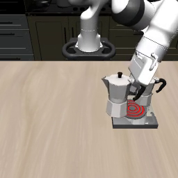
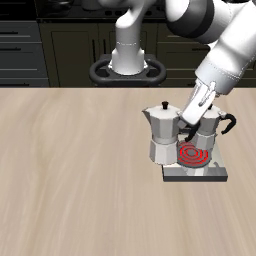

# LIBERO 上的 RLT 与 π0.5 优化实验

本仓库保存 RLT 工作目录中完整的自编实验脚本、修改后的 AlphaBrain 源码、评测配置与记录，以及 **353 段仿真回放**。本地训练产生的 17 个权重文件和 35 个回放数组放在 [v1.0 发布附件](artifacts/README.md)中；12 GB 的基础模型权重来自上游项目，按原始来源获取。

## 最终留出测试

在 LIBERO-10 Moka 任务上，使用初始状态 40–49、随机种子 789 和 1011，对基础 π0.5 与候选直接动作策略进行相同条件的 20 回合评测：

| 策略 | 成功回合 |
| --- | ---: |
| 基础 π0.5 | 12/20 |
| 候选策略 | 10/20 |

候选策略在 3 个条件下由失败转为成功，在 5 个条件下由成功转为失败。**本次最终测试没有证明候选策略优于基础策略。** [汇总](results/pi05_moka_direct_dense_interp_a050_20260910_remote_final/summary.json)、[评测协议](results/pi05_moka_direct_dense_interp_a050_20260910_remote_final/protocol.json)、[逐回合结果](results/pi05_moka_direct_dense_interp_a050_20260910_remote_final/episodes.json)和[完整结果索引](docs/results.md)均可查看。

| 候选成功、基础失败 | 基础成功、候选失败 |
| --- | --- |
|  |  |
| [候选视频](results/pi05_moka_direct_dense_interp_a050_20260910_remote_final/candidate_seed789_init42_success.mp4) · [基础视频](results/pi05_moka_direct_dense_interp_a050_20260910_remote_final/baseline_seed789_init42_fail.mp4) | [基础视频](results/pi05_moka_direct_dense_interp_a050_20260910_remote_final/baseline_seed1011_init42_success.mp4) · [候选视频](results/pi05_moka_direct_dense_interp_a050_20260910_remote_final/candidate_seed1011_init42_fail.mp4) |

截图来自对应的仿真录像；成功与否以逐回合评测记录为准。

## 代码与复现

- [`scripts/`](scripts/)：训练、评测、配对对照、监控和报告生成。
- [`src/AlphaBrain-opt/`](src/AlphaBrain-opt/)：在 [AlphaBrain](https://github.com/AlphaBrainGroup/AlphaBrain) 基础上修改的完整源码，保留上游 MIT 许可证。
- [`config/`](config/)：LIBERO 配置示例；将 [LIBERO](https://github.com/Lifelong-Robot-Learning/LIBERO) 放入 `src/LIBERO` 后运行 `python scripts/configure_libero.py` 生成本机路径。
- [`manifests/`](manifests/) 和 [`results/`](results/)：来源校验、评测协议、完整文本结果及所有可用回放。

基础模型由[原发布方](https://huggingface.co/AlphaBrainGroup/qwenoft-5traj-libero-goal)提供；[OpenPI](https://github.com/Physical-Intelligence/openpi) 和 LIBERO 的源码及仿真资产按上游安装说明获取。本仓库记录独立实验，不是上述项目的官方发布。
